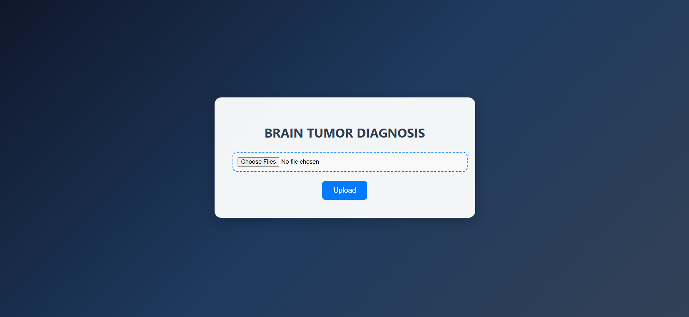
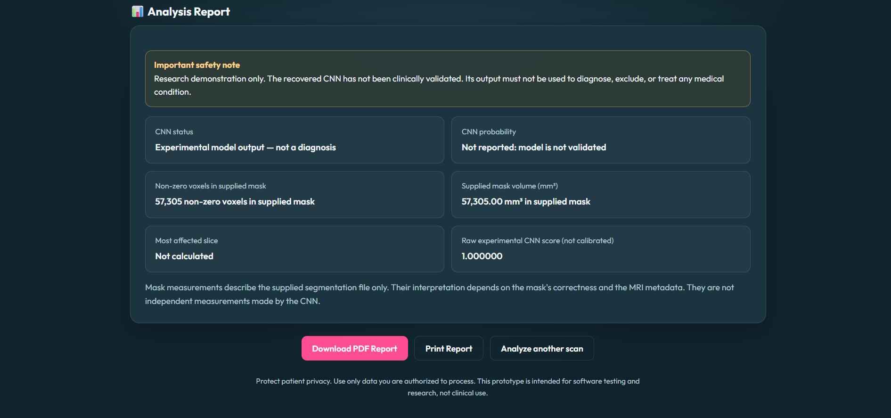

# 3D CNN Brain Tumor Detection

A Python project that explores brain MRI analysis using a 3D Convolutional Neural Network (3D CNN). It combines MRI file validation, interactive 3D visualization, and experimental model inference in a Flask web application.

## About the Project

Brain MRI scans contain information across multiple image slices. Viewing and processing these scans requires tools that can read medical image files, prepare the data, and display it in a useful way.

I built this project to explore how Python, deep learning, and 3D visualization can work together in a single application. It brings several steps of the MRI analysis workflow into one place.

This is an educational and research project, not a clinically validated diagnostic system.

## The Problem

Working with 3D MRI data can involve several separate steps, including checking files, preparing image data, running a model, and viewing the results. These steps can be difficult to manage when using different tools.

## The Solution

This project provides a web application where users can upload MRI files, check their validity, view an interactive 3D visualization, and examine experimental CNN output when a compatible trained model is available.

The aim is to make the workflow easier to explore and understand through a simple web interface.

## Key Features

- **MRI file validation:** Checks the required files and their image data before processing.
- **3D CNN inference:** Runs an experimental deep-learning model when a compatible model file is available.
- **Interactive 3D visualization:** Displays MRI data and the supplied segmentation mask.
- **Segmentation measurements:** Calculates voxel counts and an approximate volume from the supplied mask and voxel spacing.
- **Web interface:** Brings file upload, visualization, and report viewing together in one application.
- **Report options:** Provides options to download a PDF report, print the report, or analyze another scan.

The model output and mask-based measurements have not been clinically validated.

## How It Works

1. **Upload:** Select the folder containing the five required NIfTI files for the same patient.
2. **Validate:** The application checks the expected filenames and validates the image data.
3. **Prepare the MRI:** The T1 volume is normalized, 64 slices are sampled, and each slice is resized to 128 × 128 pixels.
4. **Run the model:** The prepared volume is passed to the trained CNN when a compatible model is available.
5. **View the visualization:** The application creates an interactive 3D view using the supplied MRI data and segmentation mask.
6. **Review the report:** The results page displays the experimental model output and measurements calculated from the supplied mask.

The model output is not a calibrated probability or a medical diagnosis. The supplied segmentation mask is not a segmentation generated by the CNN.

## Technology Stack

| Technology | How it is used |
|---|---|
| Python | Main programming language |
| TensorFlow | Loads and runs the CNN model |
| Flask | Runs the web application and handles uploads |
| NumPy | Performs numerical operations on image data |
| NiBabel | Reads NIfTI medical image files |
| Plotly | Creates interactive 3D visualizations |
| scikit-learn | Supports machine-learning experiments |
| OpenCV | Supports image resizing in experimental prediction code |
| HTML and CSS | Build and style the web interface |

## Required Input Files

The application expects five NIfTI files for the same patient:

- `<patient>_t1.nii.gz`
- `<patient>_t1ce.nii.gz`
- `<patient>_t2.nii.gz`
- `<patient>_flair.nii.gz`
- `<patient>_seg.nii.gz`

The combined upload limit is 200 MB.

Use files that you are authorized to access. Do not publish identifiable patient information, private scans, or medical datasets without the necessary permission.

## Application Preview

### Home Page



### 3D MRI Visualization and Analysis Report



## Getting Started

### Requirements

Before running the application, you need:

- Python installed on your computer.
- The dependencies listed in `requirements.txt`.
- A compatible trained CNN model for inference.
- Authorized MRI test files in the required NIfTI format.

The trained model and medical datasets are not included in this repository.

### 1. Open the Project

Open PowerShell in the project directory.

### 2. Create a Virtual Environment

Run these commands:

```powershell
python -m venv .venv
.\.venv\Scripts\python.exe -m pip install --upgrade pip
.\.venv\Scripts\python.exe -m pip install -r requirements.txt
```

### 3. Add the Trained Model

The application expects the trained model at:

`models/brain_tumor_cnn.h5`

The model is excluded from the repository because of its size. Obtain the correct model separately and place it at the expected path before running inference.

A different model may not work with the application's input shape or preprocessing steps.

### 4. Start the Application

Run:

```powershell
.\.venv\Scripts\python.exe app.py
```

Open the following address in your browser:

[http://127.0.0.1:5000](http://127.0.0.1:5000)

The application runs locally on your computer. This address is not a public website.

### 5. Try the Application

Select the folder containing the five required NIfTI files for one patient, then follow the upload workflow.

Only use data you are authorized to process. Do not use real patient scans simply to create a demonstration.

## Testing and Results

The following checks have been completed in the local development environment:

- Python source files compile successfully.
- The Flask application imports, and its basic routes respond as expected.
- The saved model loads with an input shape of `(None, 64, 128, 128, 1)` and an output shape of `(None, 1)`.
- A synthetic MRI volume passes the candidate preprocessing test.
- Inference completes on a synthetic test volume.

These checks confirm basic software behavior. They do not establish diagnostic accuracy or performance on real patient data. Results from synthetic inputs must not be interpreted as validated tumor predictions.

## Current Limitations

- The trained model and medical datasets are not included.
- Inference requires a compatible model at `models/brain_tumor_cnn.h5`.
- The original training pipeline and its equivalence to the current inference preprocessing have not been fully established.
- The model output is experimental and is not a calibrated or clinically validated probability.
- An intensity-based threshold is not a validated tumor segmentation.
- Measurements depend on the supplied segmentation mask and should not be treated as clinical measurements.
- Successful installation or inference does not establish diagnostic accuracy.
- The application has not been validated for clinical use.

## Future Improvements

- Evaluate the model using a documented dataset and appropriate evaluation methods.
- Verify consistency between training and inference preprocessing.
- Add reproducible tests using authorized sample data.
- Improve input validation and error messages.
- Record a short demonstration of the application.
- Review third-party licenses and attributions before distributing additional demo assets.

## Who Is This Project For?

This project is intended for students, developers, and researchers interested in Python, medical image processing, deep learning, and interactive visualization.

It provides a practical way to explore how these technologies can be combined in a research prototype.

## License

This project is licensed under the MIT License. See [LICENSE](LICENSE) for details.

## Disclaimer

This project is for educational and research purposes only. It is not a medical device and must not be used to diagnose, treat, or make medical decisions about any condition. Always consult qualified healthcare professionals for medical advice.
