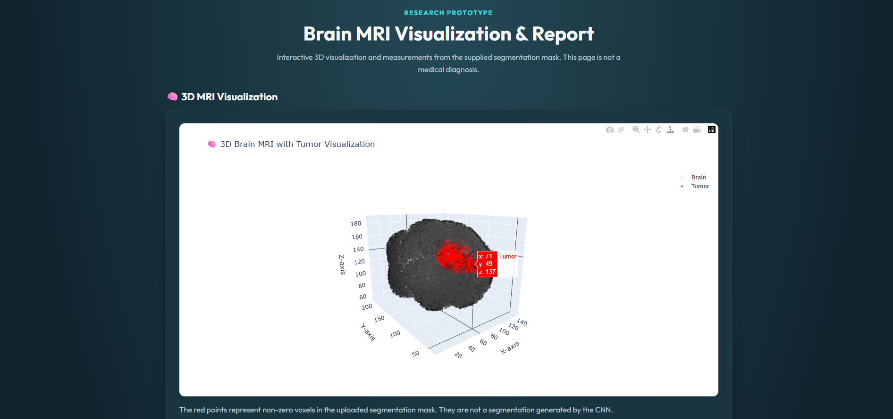

# Brain Tumor Detection Using 3D CNN

An academic project developed in **April 2025** to explore brain MRI processing, 3D visualization, and experimental brain tumor detection using Python and a 3D Convolutional Neural Network (3D CNN).

The project combines medical image validation, interactive 3D visualization, and experimental model inference in a local Flask web application.

## About the Project

Brain MRI scans contain information across multiple image slices. Working with these scans requires tools to read medical image files, prepare the data, and visualize the images.

This project brings several of these tasks together in one web application. Users can upload MRI-related NIfTI files, validate the inputs, explore an interactive 3D visualization, and view experimental model output when a compatible trained model is available.

The project demonstrates the integration of Python, deep learning, medical image processing, and web application development in an academic prototype.

## The Problem

Working with 3D MRI data involves several steps, including:

- Checking whether the required medical image files are available.
- Reading and preparing volumetric MRI data.
- Exploring brain images through visualization.
- Running a compatible deep learning model.
- Presenting the results through a usable interface.

Managing these tasks across separate tools can make the workflow harder to follow.

## The Solution

The application provides a Flask-based interface for uploading MRI-related files, validating the inputs, viewing interactive 3D visualizations, and examining experimental 3D CNN output.

It brings image-processing utilities and a deep learning inference workflow into one local application.

The application is an educational prototype. Its output has not been clinically validated and must not be treated as a medical diagnosis.

## Key Features

- **MRI file validation:** Checks the required input files before processing.
- **Multiple MRI inputs:** Supports T1, T1ce, T2, FLAIR, and segmentation-mask files.
- **3D visualization:** Provides interactive visualization of MRI data.
- **Experimental 3D CNN inference:** Supports model inference when a compatible trained model is available.
- **Input preparation:** Prepares MRI data for the expected model input format.
- **Segmentation measurements:** Displays measurements derived from the supplied segmentation mask.
- **Web interface:** Brings file upload, visualization, and results presentation together in one application.

## How It Works

1. **Upload the files:** Select the five required NIfTI files associated with the same patient.
2. **Validate the inputs:** The application checks the required files and their suitability for processing.
3. **Prepare the MRI data:** The T1 image is normalized, 64 slices are sampled, and the slices are resized to 128 × 128 pixels.
4. **Visualize the data:** The application provides an interactive 3D visualization.
5. **Run experimental inference:** When a compatible trained model is available, the prepared input can be passed to the model.
6. **Review the results:** The interface presents experimental model output and measurements calculated from the supplied segmentation mask.

The supplied segmentation mask is not generated by the CNN. The model's output score is experimental and must not be interpreted as a calibrated probability of disease.

## Screenshots

### 1. Application Home Page


The home page provides the starting point for the MRI upload workflow.

### 2. 3D MRI Visualization



The interactive visualization displays MRI data and the supplied segmentation mask.

### 3. Analysis Report


The report displays experimental model output and measurements derived from the supplied segmentation mask. The displayed model score is not a validated medical prediction.

## Technology Stack

| Technology | Purpose |
|---|---|
| Python | Main programming language |
| TensorFlow | Deep learning model inference |
| Flask | Local web application and routing |
| NumPy | Numerical operations and image-data preparation |
| NiBabel | Reading NIfTI medical imaging files |
| Plotly | Interactive visualization |
| OpenCV | Image-processing utilities |
| scikit-learn | Supporting machine learning utilities |
| HTML and CSS | Web interface structure and styling |
| Werkzeug | Flask-related request and file-handling utilities |

These technologies reflect the project's dependencies and implementation. Not every dependency participates in every processing step.

## Project Structure

```text
brain-tumor-detection-system/
├── app.py
├── requirements.txt
├── README.md
├── LICENSE
├── models/
│   └── README.md
├── screenshots/
│   ├── home-page.png
│   ├── mri-visualization.png
│   └── results-report.png
├── src/
│   ├── brain_3d_visualization.py
│   ├── brain_tumor_training_experiment.py
│   ├── mri_3d_visualization.py
│   ├── mri_input_validation.py
│   ├── multiclass_segmentation_experiment.py
│   ├── train_3d_cnn.py
│   ├── tumor_analysis_experiment.py
│   ├── tumor_prediction.py
│   └── tumor_prediction_candidate.py
└── templates/
    ├── index.html
    └── output.html
```

The `src/` directory contains image-processing, visualization, training, and prediction-related modules. The `templates/` directory contains the HTML templates used by Flask. The `models/` directory documents the trained model requirements.

## Required Input Files

The application expects five NIfTI files associated with the same patient:

| File suffix | Purpose |
|---|---|
| `_t1.nii.gz` | T1-weighted MRI |
| `_t1ce.nii.gz` | T1 contrast-enhanced MRI |
| `_t2.nii.gz` | T2-weighted MRI |
| `_flair.nii.gz` | FLAIR MRI |
| `_seg.nii.gz` | Segmentation mask |

The combined upload limit is **200 MB**.

Use only data authorized for processing. Do not publish identifiable patient information, private scans, or medical datasets without the necessary permission.

## Getting Started

### Prerequisites

- Python compatible with the project's declared dependencies.
- Git, if cloning the repository.
- The dependencies listed in `requirements.txt`.
- Suitable NIfTI input files for testing the workflow.
- A compatible trained CNN model if model inference is required.

The trained model and medical datasets are not included in the public repository.

### 1. Clone the Repository

```bash
git clone https://github.com/abdulfadhil/brain-tumor-detection-system.git
cd brain-tumor-detection-system
```

### 2. Create a Virtual Environment

On Windows, run:

```powershell
python -m venv .venv
.\.venv\Scripts\python.exe -m pip install --upgrade pip
```

### 3. Install Dependencies

```powershell
.\.venv\Scripts\python.exe -m pip install -r requirements.txt
```

Use a Python version compatible with the declared dependencies. If installation fails, check Python and package compatibility before changing dependency versions.

### 4. Configure the Trained Model

The application expects the trained model at:

```text
models/brain_tumor_cnn.h5
```

The model is excluded from the repository because of its size. A compatible model must be obtained separately and placed at the expected path before running inference.

A different model may not work with the application's expected input shape or preprocessing steps. Refer to `models/README.md` for further information.

### 5. Start the Application

Run:

```powershell
.\.venv\Scripts\python.exe app.py
```

Open the following address in a browser:

http://127.0.0.1:5000

The application runs locally on the computer. This address is not a publicly hosted website.

### 6. Use the Application

1. Open the application in the browser.
2. Select the five required NIfTI files for the same patient.
3. Follow the upload and validation workflow.
4. Review the available 3D visualization and experimental output.

Only use data authorized for processing. Successful upload or model execution does not establish diagnostic accuracy.

## Testing and Results

Basic software checks performed during development include Python syntax compilation and importing the Flask application. The application registered the following routes:

- `/`
- `/upload`
- `/static/<path:filename>`

These checks confirm basic application structure and import behavior. They do not establish that the trained model reliably detects tumors in real clinical scans.

Model-loading, synthetic-inference, and diagnostic-performance claims should be included only when supported by reproducible test results. No clinical performance claim is made by this project.

## Current Limitations

- The trained model and medical datasets are not included in the public repository.
- Inference requires a compatible model at `models/brain_tumor_cnn.h5`.
- The model's training pipeline and its consistency with inference preprocessing require further verification.
- The model output is experimental and is not a calibrated probability.
- The supplied segmentation mask is used for related measurements; the CNN does not generate that mask.
- Measurements derived from the mask are not validated clinical measurements.
- Successful installation or inference does not establish diagnostic accuracy.
- The application has not been clinically validated.
- The application runs locally and is not publicly hosted by default.

## Future Improvements

- Evaluate the model using a documented dataset and appropriate evaluation methods.
- Verify consistency between training and inference preprocessing.
- Add reproducible tests using authorized sample data.
- Improve input validation and error messages.
- Document the model architecture, training data, and preprocessing in greater detail.
- Improve the visualization and user interface.
- Review third-party licenses and attributions before distributing additional demonstration assets.

These are potential improvements, not claims that the features have already been implemented.

## License

This project is distributed under the MIT License. See the [LICENSE](LICENSE) file for details.

## Medical Disclaimer

This project is provided for educational and research purposes only. It is not a medical device and has not been clinically validated. Its output must not be used to diagnose a condition, guide treatment, or replace advice from qualified healthcare professionals.
